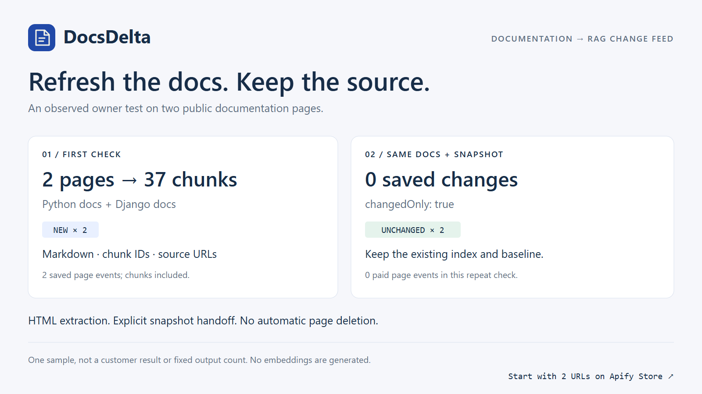

# Try DocsDelta on two documentation pages

Use this when your RAG index needs to know which documentation chunks changed.
DocsDelta provides Markdown and chunk updates; your application performs the
embedding and vector-store writes.



## First run

1. Open [DocsDelta on Apify](https://apify.com/reliable_quatrain/website-markdown-rag-change-feed).
2. Paste the input below in the JSON input editor. Keep the first test small.
3. Under Run options, set **Maximum cost per run** to **$0.01**, then start.

```json
{
  "urls": [
    "https://docs.python.org/3/tutorial/datastructures.html",
    "https://docs.djangoproject.com/en/stable/intro/overview/"
  ],
  "maxPages": 2,
  "followLinks": false,
  "changedOnly": false
}
```

At the configured $0.003/page rate, two saved pages correspond to $0.006 in
Actor events. Consult the current Pricing tab and your account's charges before
running. Failed or skipped pages have no custom page event. Free credits may
cover a test according to your account; a trial is not guaranteed to be free.

In the output, inspect **Saved document checks** and **Flattened RAG chunks**.
Each chunk has an ID, text and source URL. Download **Next-run snapshot** as JSON.
Read **Run summary** and diagnostics if a page did not produce a saved row.

An owner test produced 2 NEW pages and 37 chunks on these URLs. This is one
observed sample, not a fixed output count, speed promise or customer benchmark.

## Repeat the same check

Use the same URLs, add `"changedOnly": true`, and set `previousSnapshot` to the
entire JSON snapshot from the first run. Do not paste a placeholder or merely
the key-value-store ID.

If the extracted content and chunk layout are unchanged, those pages are
filtered and have no saved page event. If content changes, the returned rows
contain the current chunks, added IDs, removed IDs and a bounded readable diff.
The supplied source pages can change between tests.

Upsert chunks by ID and remove only IDs explicitly returned for a successfully
refetched page. Keep the new snapshot for the next run. A failed, blocked or
oversized page preserves its old baseline; a missing page is never automatically
declared deleted. An empty changes dataset is an expected result when nothing
changed, not evidence that your entire index should be cleared.

## Does it fit your workflow?

Try one or two public HTML documentation URLs you already maintain or may
process. Check whether the extracted text is correct and the sources are useful.
If a menu is included, try `contentCssSelector` or `excludeCssSelectors`. If the
page relies on client-side JavaScript, this HTTP-only release may not fit.

When reporting an issue, include the public URL, relevant input settings and
expected output. Never include account tokens, cookies or private documents.

For automation, see [the Vietnamese workflow guide](WORKFLOW_COOKBOOK_VI.md).
A schedule alone does not reload the previous snapshot; the calling workflow
must pass it in. No particular n8n template or vector database is bundled.

The new [incremental indexing guide](INCREMENTAL_INDEXING.md) documents a flat
`CHUNK_OPERATIONS` / NDJSON feed and local checkpoint flags. Changed pages emit
explicit REMOVE and UPSERT records; unchanged pages emit none. Finish applying
the batch to your index before promoting the new snapshot.
